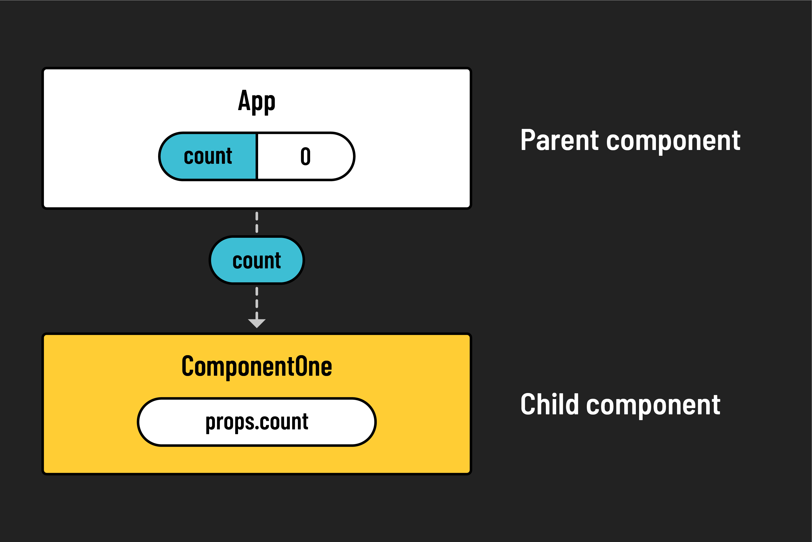
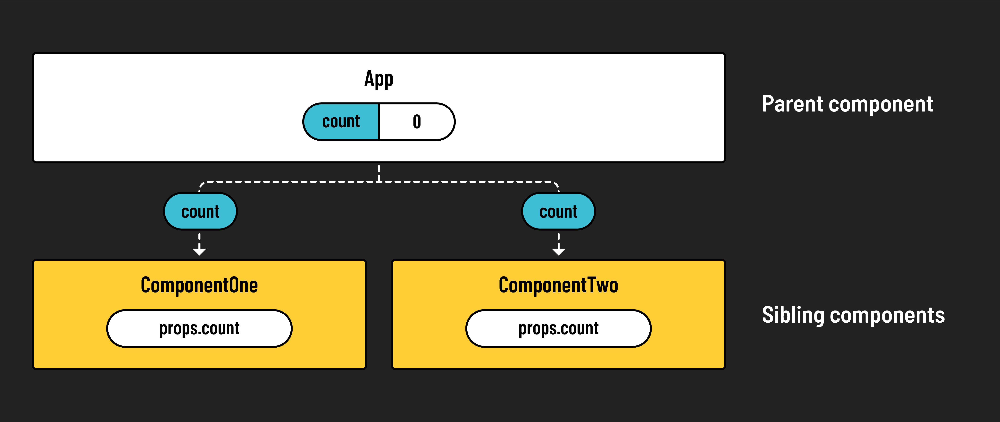
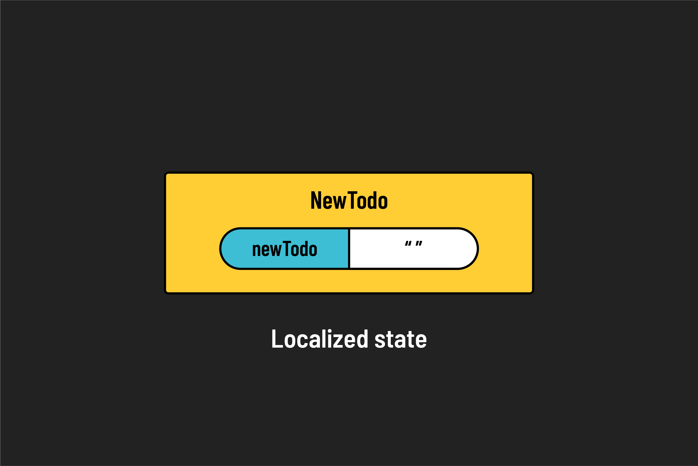
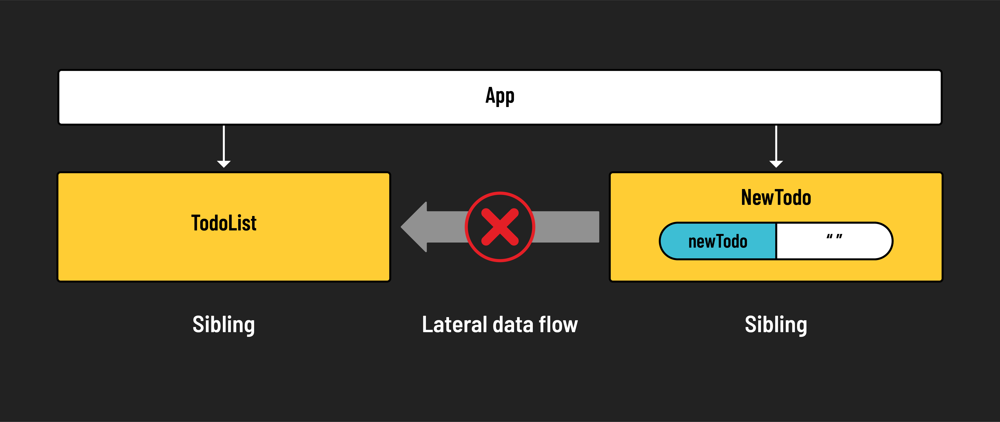
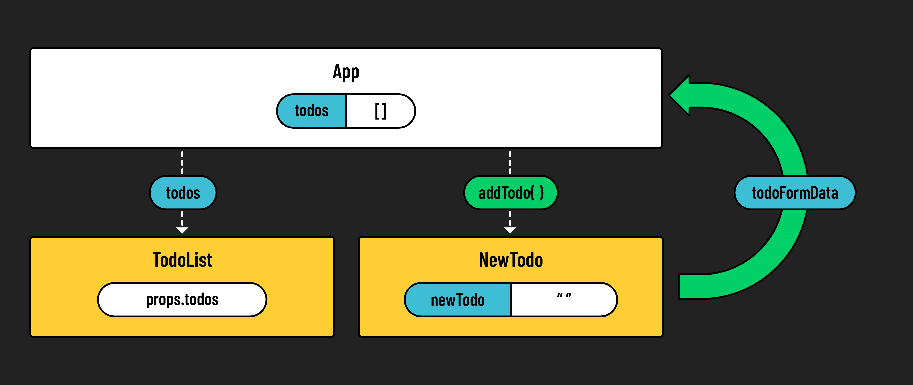

# 

**Learning objective:** By the end of this lesson, students will be able to tktk

## Data flow in React

React enforces a **unidirectional data flow**, where data travels in one direction down the component tree, from parent to child. This structure simplifies the state management of your application and can make debugging more straightforward. However, this pattern presents a challenge when child components need to communicate changes back to their parent or to siblings.

To illustrate, consider the following scenarios involving state in React:

- **Passing state:** State can be held in a parent and passed down to a child component through props.
  

- **Shared state:** State held in a common parent can be shared by multiple sibling components.
  

- **Localized state:** A component can have its own localized state, updating in response to user inputs without affecting the broader app.
  

Now, consider a scenario where a child component needs to transfer its localized state to a sibling. A form component for example, might submit data that needs to be displayed by a sibling list component. Here, we encounter the issue with unidirectional data flow, as React doesn't allow for upward or lateral state changes. 

This is where the concept of **lifting state** comes in to play.

## Lifting state

**Lifting state** is the practice of moving state up to a common ancestor of components that need access to that piece of state. It often involves passing a function down as a prop, and using that function to update state. 

By defining a state-updating function and passing it from the parent to child, children can modify the parent's state by calling upon the function. The change then cascades down to other components that share that state. This approach allows for the upward flow of information through the component hierarchy, effectively *lifting the state*.

Let's see an example of this concept using a todo app:

In our todo app, the `App` component, which holds the state for `todos`, includes both a `TodoList` for displaying todos and a `NewTodo` form for adding them. The `addTodo` function within `App` updates the state with new todos, and is accessible inside of `NewTodo` through `props`. When a todo is submitted, `NewTodo` calls upon `addTodo`, updating the state held in `App`, which in turn triggers a rerender so that the changes are reflected in `TodoList`.

tktk Should this move to the end of the module?
> 🏆 When designing an application and determining where to hold the state, consider where state needs to flow. What components are dependent on this state? What needs to receive and manipulate this data? These questions will guide you in determining the appropriate location for your application's state.