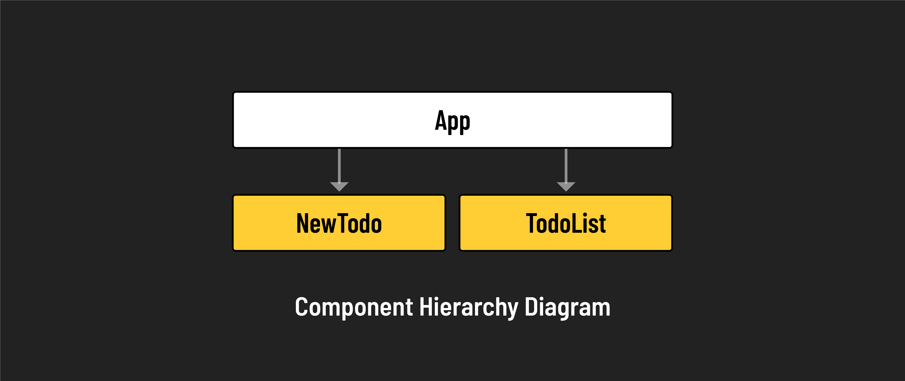

# 

**Learning objective:** By the end of this lesson, students will be able to transfer state from one component to its parent

## Overview

Let's practice the concept of lifting state with a real-world example. We'll construct a Todo application in which data is passed from a child component to its parent. 

Our Todo app will consist of the following:



- **App (parent component)**: The main component that holds state and the child subcomponents.
- **NewTodo (child component)**: A form component for creating new todo items.
- **TodoList (child component)**: A list component responsible for rendering the todos held in state.

### Setting up `App.jsx`

We can now remove the counter functionality from `src/App.jsx`.

Update `App.jsx` with the following:

```jsx
// src/App.jsx
const App = () => {

    const addTodo = (newTodo) => {
        console.log(newTodo);
    };

    return (
        <>
            <h1>To Do App</h1>
        </>
    );
};

export default App;
```

Check your browser and confirm that the 'To Do App' is being rendered.

### Creating the `NewTodo` form

In your terminal, create a new component file:

```bash
touch src/components/NewTodo.jsx
```

In `src/components/NewTodo.jsx`, add the following:

```jsx
// src/components/NewTodo.jsx
const NewTodo = (props) => {
    const handleSubmit = (event) => {
        event.preventDefault();
        console.log("Creating a new To-Do...");
    };

    return (
        <form onSubmit={handleSubmit}>
            <input type="text" />
            <button>Create Todo</button>
        </form>
    );
};

export default NewTodo;
```

Now let's import it at the top of `src/App.jsx`:

```js
// src/App.jsx
import NewTodo from './components/NewTodo.jsx';
```

And now add the component within the `return` statement of `App.jsx`:

```jsx
// src/App.jsx
    return (
        <>
            <h1>To Do App</h1>
            <NewTodo />
        </>
    );
```

Check your browser. You should now see that the form has been added to the page.  

Click the "Create Todo" button on the page and check your browser's dev tools console for the logged text "Creating a new Todo...".

### Passing `addTodo` to the `NewTodo` form

Now we want to pass `addTodo` down from `App.jsx` to `NewTodo.jsx` in much the same way that we passed `addOne` down from `App.jsx` to `IncrementButton.jsx`.

Make the following adjustment to the `return` statement of `src/App.jsx`:

```jsx
// src/App.jsx
    return (
        <>
            <h1>To Do App</h1>
            <NewTodo addTodo={addTodo} />
        </>
    );
```

Now the `addTodo` function, defined in `App.jsx` will be available within `NewTodo.jsx` as `props.addTodo`. Let's use that within our `handleSubmit` function:

```jsx
    // src/components/NewTodo.jsx
    const handleSubmit = (event) => {
        event.preventDefault()
        props.addTodo('data created within NewTodo component')
    };
```

Back in the browser, click the "Create Todo" button and check the console to ensure the text "data created within NewTodo component" has been logged. The important thing here is that the text was logged by `addTodo` in `App.jsx`. This function was called by `handleSubmit` within `NewTodo.jsx`. There, we passed `props.addTodo` an argument of `'data created within NewTodo component'`.

### Setting up state for the `New Todo` form

At this point, we can pass information to the parent, via the `addTodo` function. Sadly, we're only passing the string "data created within NewTodo component" which is not terribly exciting. Let's create an input so the user can enter text, which will then be passed to `props.addTodo` instead of the static text.

At the top of `NewTodo.jsx` import `useState`, so that we can keep track of what the user has typed:

```js
import { useState } from 'react';
```

Now initialize the state and its setter function inside the `NewTodo` function:

```js
const [newTodo, setNewTodo] = useState('')
```

Update your form in `NewTodo.jsx` like so:

```jsx
// src/components/NewTodo.jsx
    <form>
        {newTodo}
        <input type="text" onChange={handleChange}/>
        <button>Create Todo</button>
    </form>
```

Finally, create the `handleChange` function, which will be called when the user types in the text input. It will invoke `setNewTodo`, passing in the value of the input that the user entered:

```jsx
// src/components/NewTodo.jsx
const handleChange = (event) => {
    setNewTodo(event.target.value)
};
```

Test this out in the browser by typing something into the text input. By adding `{newTodo}` in our JSX you should be able to see the value of state change in real time as the user input changes in the text box.

### Passing form state to `addTodo`

Great! Our form has its own internal state, but the text "data created within NewTodo component" is still being passed to `props.addTodo`. Let's pass the `newTodo` state variable instead!

In `NewTodo.jsx`, update your `handleSubmit` function like so:

```jsx
    // src/components/NewTodo.jsx
    const handleSubmit = (event) => {
        event.preventDefault()
        props.addTodo(newTodo)
    };
```

Check back in the browser. Type something into the input and click the "Create Todo" button. You should now see that the browser console has logged your input text. Yay!

Let's do some quick cleanup. Let's remove the `{newTodo}` from inside the `<form>` tag in `NewTodo.jsx`. This was just a temporary way to view state as it changed.

And lastly, let's add a new feature to improve the user experience. When we click the "Create Todo" button, the text we entered in the `<input>` tag remains. It'd be nice if that value was cleared out so that it's easier for the user to enter additional Todo items. Adjust the `<input>` tag like so:

```jsx
        // src/components/NewTodo.jsx
        <input type="text" onChange={handleChange} value={newTodo}/>
```

Notice that we've set the `value` attribute of the `<input>` tag to `{newTodo}`, which is being updated as the user types. By binding the value of the input to state, we can control the input text from our state variable and clear it when needed. Adjust the `handleSubmit` function like so:

```jsx
    // src/components/NewTodo.jsx
    const handleSubmit = (event) => {
        event.preventDefault()
        props.addTodo(newTodo)
        setNewTodo('')
    };
```

Now, when we click "Create Todo" the `newTodo` state variable is set to the empty string. This gets reflected in the `<input>` tag, removing any text the user had typed.

Try out using the form in the browser, and check the Dev Tools console. Everything you type should show up there. Congratulations! The `NewTodo` form is complete, and we've successfully lifted its `newTodo` state variable up to the `App` component!

