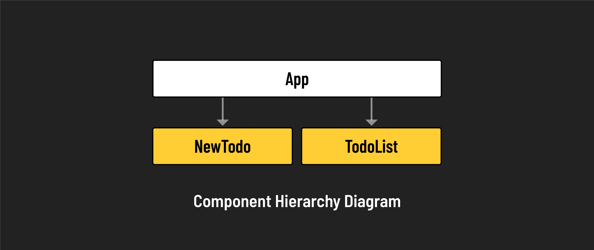

# 

**Learning objective:** By the end of this lesson, students will be able to transfer state from one component to its parent and siblings

## Overview

Let's practice the lifting state concept with a real-world example. We'll construct a Todo application in which data is passed from a child component to its parent. 

Our Todo app will consist of the following:



- **App (parent component)**: The main component that holds state and the child subcomponents.
- **NewTodo (child component)**: A form component for creating new todo items.
- **TodoList (child component)**: A list component responsible for rendering the todos held in state.

### Setting up `App.jsx`

We can now remove the counter functionality from `src/App.jsx`.

Update `App.jsx` with the following:

```jsx
// src/App.jsx
const App = () => {

    const addTodo = (newTodo) => {
        console.log(newTodo);
    };

    return (
        <>
            <h1>To Do App</h1>
        </>
    );
};

export default App;
```

Check your browser and confirm that the 'To Do App' is being rendered.

### Creating the `NewTodo` form

In your terminal, create a new component file like so:

```bash
touch src/components/NewTodo.jsx
```

In `src/components/NewTodo.jsx`, add the following:

```jsx
// src/components/NewTodo.jsx
const NewTodo = (props) => {
    const handleSubmit = (event) => {
        event.preventDefault();
        console.log("Creating a new To-Do...");
    };

    return (
        <form onSubmit={handleSubmit}>
            <input type="text" />
            <button>Create Todo</button>
        </form>
    );
};

export default NewTodo;
```

Now let's import it at the top of `src/App.jsx`:

```js
// src/App.jsx
import NewTodo from './components/NewTodo.jsx';
```

And now instantiate it within the `return` statement of `App.jsx`:

```jsx
// src/App.jsx
    return (
        <>
            <h1>To Do App</h1>
            <NewTodo />
        </>
    );
```

Check your browser. You should now see that the form has been added to the page.  

Click the "Create Todo" button on the page and check your browser's dev tools console for the logged text "Creating a new Todo...".

### Passing `addTodo` to the `NewTodo` form

Now we want to pass `addTodo` down from `App.jsx` to `NewTodo.jsx` in much the same way that we passed `addOne` down from `App.jsx` to `IncrementButton.jsx`.

Make the following adjustment to the `return` statement of `src/App.jsx`:

```jsx
// src/App.jsx
    return (
        <>
            <h1>To Do App</h1>
            <NewTodo addTodo={addTodo} />
        </>
    );
```

Now the `addTodo` function, defined in `App.jsx` will be available within `NewTodo.jsx` as `props.addTodo`. Let's use that within our `handleSubmit` function:

```jsx
    // src/components/NewTodo.jsx
    const handleSubmit = (event) => {
        event.preventDefault()
        props.addTodo('data created within NewTodo component')
    };
```

Back in the browser, click the "Create Todo" button and check the console to ensure the text "data created within NewTodo component" has been logged. The important thing here is that the text was logged by `addTodo` in `App.jsx`. This function was called by `handleSubmit` within `NewTodo.jsx`. There, we passed `props.addTodo` an argument of `'data created within NewTodo component'`.


### Setting up state for the `New Todo` form

At this point, we can pass information to the parent, via the `addTodo` function. Sadly, we're only passing the string "data created within NewTodo component" which is not terribly exciting. Let's create an input so the user can enter text, which will then be passed to `props.addTodo` instead of the static text.

At the top of `NewTodo.jsx` import `useState`, so that we can keep track of what the user has typed:

```js
import { useState } from 'react';
```

Now initialize the state and its setter function inside the `NewTodo` function:

```js
const [newTodo, setNewTodo] = useState('')
```

Update your form in `NewTodo.jsx` like so:

```jsx
// src/components/NewTodo.jsx
    <form>
        {newTodo}
        <input type="text" onChange={handleChange}/>
        <button>Create Todo</button>
    </form>
```

Finally, create the `handleChange` function, which will be called when the user types in the text input. It will invoke `setNewTodo`, passing in the value of the input that the user entered:

```jsx
// src/components/NewTodo.jsx
const handleChange = (event) => {
    setNewTodo(event.target.value)
};
```

Test this out in the browser by typing something into the text input. You should see the exact text appear right before the input. We put `{newTodo}` after our `<form>` tag.

### Passing form state to `addTodo`

Great! Our form has its own internal state, but the text "data created within NewTodo component" is still being passed to `props.addTodo`. Let's pass the `newTodo` state variable instead!

In `NewTodo.jsx`, update your `handleSubmit` function like so:

```jsx
    // src/components/NewTodo.jsx
    const handleSubmit = (event) => {
        event.preventDefault()
        props.addTodo(newTodo)
    };
```

Check back in the browser. Type something into the input and click the "Create Todo" button. You should now see that the browser console has logged your input text. Yay!

Just a cleanup now. Let's remove the `{newTodo}` from inside the `<form>` tag in `NewTodo.jsx`. That was a bit of debugging that we don't need anymore.

And lastly, let's add a nice little User Experience feature. When we click the "Create Todo" button, the text we entered in the `<input>` tag remains. It'd be nice if that value was cleared out so that it's easier for the user to enter additional Todo items. Adjust the `<input>` tag like so:

```jsx
        // src/components/NewTodo.jsx
        <input type="text" onChange={handleChange} value={newTodo}/>
```

Notice that we've set the `value` attribute of the `<input>` tag to `{newTodo}`, which is being updated as the user types. This might seem unnecessary, even a bit circular, but it helps when it comes time to clear the input. Adjust the `handleSubmit` function like so:

```jsx
    // src/components/NewTodo.jsx
    const handleSubmit = (event) => {
        event.preventDefault()
        props.addTodo(newTodo)
        setNewTodo('')
    };
```

Now, when we click "Create Todo" the `newTodo` state variable is set to the empty string. This gets reflected in the `<input>` tag, removing any text the user had typed.

Try out using the form in the browser, and check the Dev Tools console. Everything you type should show up there. Congratulations! The `NewTodo` form is complete, and we've successfully lifted its `newTodo` state variable up to the `App` component!

### Setting up state for `App`

This next section aims to set up a state for the `App` component and incorporate the `newTodo` data coming up from the `<NewTodo>` child component. Let's start with the initializing the state in `App. js`. At the top of the file, import `useState`:

```js
import { useState } from 'react';
```

Inside the `App` function, initialize a state variable `todo` as an empty array and generate its setter function:

```js
    // src/App.jsx
    const [todos, setTodos] = useState([]);
```

Now comes the exciting part. We want `addTodo` to append its `newTodo` parameter onto the `todos` state array and then log `todos`. You might think you could do something like the following:

```jsx
    // src/App.jsx
    const addTodo = (newTodo) => {
        todos.push(newTodo)
        setTodos(todos)
        console.log(todos)
    };
```

BUT YOU CAN'T! One of the rules of React is that you can't manipulate a state variable outside of a setter function like `setTodos`. Instead, you have to create a new empty array, fill it up with the current values of `todos`, and then add `newTodo` to the end of it. This way, the original `todos` state variable remains untouched until `setTodos` changes it.

1. So, we start with a brand new empty array inside `addTodo`:

    ```js
    const newArray = [];
    ```

2. Now alter that statement to use the spread operator, which takes the values of an array and **spreads** them out into a new array:

    ```js
    const newArray = [...todos];
    ```

3. Now, `newArray` is a duplicate of `todos`. Let's add the `newTodo` parameter to the end of the array:

    ```js
    const newArray = [...todos, newTodo];
    ```

4. We can now pass this into `setTodos` like so:

    ```js
    const newArray = [...todos, newTodo]
    setTodos(newArray)
    console.log(todos)
    ```

5. Or more concisely:

    ```jsx
        // src/App.jsx
        const addTodo = (newTodo) => {
            setTodos([...todos, newTodo])
            console.log(todos)
        };
    ```

Whew! Check the browser. Type something into the text input and click the "Create Todo" button. Each time the button is clicked, the Dev Tools console should log the entire `todos` array with whatever was typed into the text input as its last element.

### Displaying the todos

Now that we've got the `App` component's `todos` state variable updating properly, all we need to do is display items on the page. Update the `return` statement in `App.jsx` like so:

```jsx
    // src/App.jsx
    return (
        <>
            <h1>To Do App</h1>
            <NewTodo addTodo={addTodo} />
            <ul>
                {todos.map((todo, index)=>{
                    return <li key={index}>{todo}</li>
                })}
            </ul>
        </>
    );
```

Try out the browser, and you should have a working Todo app! We have successfully lifted the state from the `<NewTodo>` form, used it to update the `<App>` component's state, and displayed the values coming up from `<NewTodo>` in `<App>`. We have gone from child to parent.


### Moving the list to its own component

Now that we've gone from the child component to the parent component let's see how to go from the child component to the sibling component. It's actually easier than you think. We just pass the `todos` state variable in `<App>` down into a new child, which we'll call `<TodoList>`. In this way, the data comes up from `<NewTodo>` into `<App>` and then goes back down into `<TodoList>`.


First, let's create a new component to hold our `<TodoList>`:

```bash
touch src/components/TodoList.jsx
```

Add the following to it:

```jsx
// src/components/TodoList.jsx
const TodoList = (props) => {
    const tempTodos = ["first", "second", "third"];
    return(
        <ul>
            {tempTodos.map((todo, index)=>{
                return <li key={index}>{todo}</li>
            })}
        </ul>
    );
};

export default TodoList;
```

There's nothing too exciting here. It's currently a standalone component with a static array that gets mapped over to generate `<li>` elements. Import that component into `App.jsx`:

```jsx
// src/App.jsx
import TodoList from './components/TodoList.jsx';
```

Add it to the `return` statement in `App.jsx` and remove the `<ul>` we created in the last section. The `return` statement in `App.js` should now look like this:

```jsx
    // src/App.jsx
    return (
        <>
            <h1>To Do App</h1>
            <NewTodo addTodo={addTodo} />
            <TodoList/>
        </>
    );
```

If you check the browser, you should see that a static three-item list has replaced our previous dynamic list. That's fine. We'll make the `<TodoList>` dynamic next.

Pass the `todos` state variable in `App.jsx` into `<TodoList/>`:

```jsx
            // src/App.jsx
            <TodoList todos={todos} />
```

Now, in `TodoList.jsx`, use `props. todos` instead of `tempTodos` (which you should remove now). This should be what `Todos.jsx` looks like when completed:

```jsx
// src/components/TodoList.jsx
const TodoList = (props) => {
    return(
        <ul>
            {props. todos.map((todo, index)=>{
                return <li key={index}>{todo}</li>
            })}
        </ul>
    );
};

export default TodoList;
```

Congrats! You have now lifted state up from `NewTodo.jsx` into `App.jsx` and then passed it back down into `TodoList.jsx`, effectively moving state from `NewTodo.jsx` to its sibling component `TodoList.jsx`.